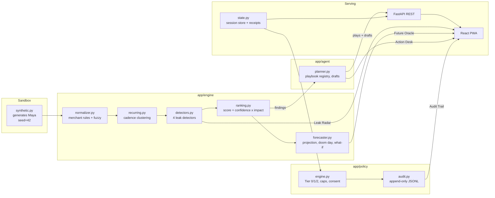
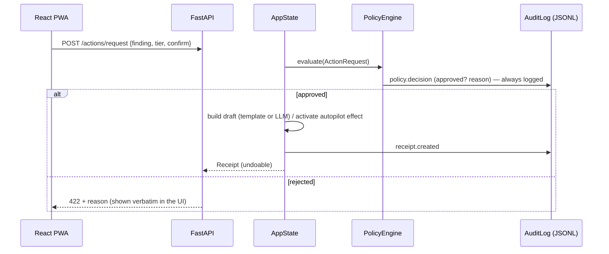

# Celengan — System Architecture

> "Detect. Simulate. Execute." An agentic personal CFO that turns bank
> statements into completed tasks, governed by a deterministic Policy Engine.
>
> Status: submission build for the 2026 Shenzhen International FinTech
> Competition, International Track, Topic A.

## 1. Design principles

1. **Determinism first.** The core pipeline — ingest, normalization, detection,
   ranking, forecasting, policy — is pure Python with a fixed seed and a
   pinned anchor day (env `CELENGAN_ANCHOR`, default the submission-date
   snapshot 2026-10-17). It runs with zero network access and zero API keys,
   and every run over the sandbox feed produces byte-identical results — the
   seeded narrative (doom day 2026-11-19, lowest −$19.85, cleared +$66.64)
   reads the same no matter when it is judged.
2. **Evidence, not vibes.** Every leak recommendation ships a *receipt*:
   transaction IDs, pattern rationale, confidence, quantified impact, and a
   mapped playbook.
3. **The money path terminates in one place.** Proposals may be generated by
   humans, templates, or an optional LLM — but execution authority lives only
   in the Policy Engine. An injected prompt cannot move, spend, or pause money.
4. **Reversible by default.** Every executed play produces an *undoable*
   receipt; the forecast immediately reflects or reverts the effect.

## 2. Component map

- **Ingest** — `backend/app/engine/...` reads the sandbox bundle produced by
  `seed/synthetic.py`: one deterministic user ("Maya"), 192 transactions over a
  185-day window, paycheck schedules, 9 merchants, usage telemetry for
  subscription-vs-usage checks.
- **Normalizer** — merchant canonicalization via a rule table plus
  `rapidfuzz` fuzzy matching (threshold-guarded) so "GYM*FLOW LTD" and
  "Gymflow Membership" resolve to one merchant; categories attached from a
  maintained map.
- **Recurring detection** — per merchant, clusters dates into cadence
  hypotheses; a series qualifies when the median gap is stable and at least 3
  occurrences exist; the series median amount and `amount_stable` flag feed
  both the forecaster and the price-hike detector.
- **Detectors (4)** —
  | # | Leak | Trigger | Quantification |
  |---|------|---------|----------------|
  | 1 | Subscription creep (dark subscriptions) | recurring charges with ≤ 0 of N expected uses logged in the last 90 days | median amount × (30 / cadence) |
  | 2 | Duplicate charge | same merchant + same amount within 24h | the duplicated amount (refundable) |
  | 3 | Hidden fees | fee-category transactions grouped by merchant (≥ 3 = recurring, else one-off penalty) | median / one-time total |
  | 4 | Silent price hike | last 2 bills ≥ 1.30 × the earlier median | price delta × (30 / cadence) |
- **Ranking** — `score = confidence × monthly_impact`; the UI and demo always
  act top-down. Session totals: Maya's seeded story yields **$65.44/mo =
  $785.28/yr across 5 findings**.
- **Forecaster** — day-zero events run first, future recurring bills are
  scheduled from each series' last occurrence (interval = cadence), and a
  signed-median *burn rate* (from non-recurring daily flows, payroll excluded)
  applies to every day. **Doom day** = first day the projected balance drops
  below zero; the seeded story locks it at day 33 (2026-11-19, lowest −$19.85).
  What-if projections accept `exclusions` (removed bill series), `discounts`
  (reduced bills, for downgrade plays) and `one_time_credits` (refunds/waivers
  posting on day 3); removing Maya's dark subscription plus the two
  refundable charges clears the doom day entirely (lowest +$66.64).

## 3. Governance — the Policy Engine

Permission ladder (implemented, `app/policy/engine.py`):

| Tier | Name | Capability | Hard rules |
|------|------|------------|------------|
| 0 | Observe | run all read-only analysis | always permitted |
| 1 | Draft | prepare dispute/waiver/cancellation letters; never sends | requires explicit `confirm` (one-tap) |
| 2 | Micro-autopilot | pause/downgrade a bill at renewal | requires prior consent; kill-switch blocks all; per-action ≤ $50; monthly ≤ $400 |

Invariants the engine enforces:

- **One active play per finding** — a second request on the same
  finding+playbook is rejected with 409; undo first.
- **Whitelisted effects only** — `recurring_exclusion`,
  `recurring_discount`, `one_time_credit`; the forecaster accepts nothing
  else, so the Action Desk can only change the projection in modeled ways.
- **Undo refunds the envelope** — undo removes the effect and releases the
  Tier-2 budget spend.
- **Session resets the consent envelope**; the audit log never resets.

Audit — `policy.audit.AuditLog` writes one JSON line per event
(`consent.updated`, `kill_switch`, `policy.decision`, `receipt.created`,
`action.undone`, `tier2.spend_*`, `session.reloaded`). There is no code path
that edits or deletes past events.

## 4. Action Desk playbooks

| Playbook | Tier 1 (draft) | Tier 2 (autopilot) | Effect on forecast |
|----------|----------------|--------------------|--------------------|
| `cancel_subscription` | cancellation email (template; LLM-upgraded if flagged) | pause at next renewal | remove bill series |
| `dispute_duplicate` | bank dispute letter, refund expected | — | +amount credit on day 3 |
| `claim_fee_refund` | fee-waiver request | — | +amount credit on day 3 |
| `renegotiate_hike` | renegotiation / downgrade letter | downgrade at next renewal | reduce bill by delta |

Receipts carry: id, status (`draft_ready` / `autopilot_active` / `undone`),
subject + ready-to-send body, generator (`template` / `policy` / `llm`),
impact note, and the evidence transaction IDs.

## 5. API surface

| Endpoint | Method | Purpose |
|----------|--------|---------|
| `/health` | GET | liveness + feature flags (LLM on/off, seed) |
| `/sandbox`, `/sandbox/reload`, `/transactions` | GET/POST | session summary, deterministic reset, normalized ledger |
| `/leaks` | GET | ranked findings + totals |
| `/forecast?days=`, `/forecast/what-if?exclude=&credits=` | GET | baseline/current pair, counterfactuals |
| `/actions/plays` | GET | live play catalog derived from findings |
| `/actions/request` | POST | policy-gated execution → receipt |
| `/actions/undo` | POST | reverse a receipt, release caps |
| `/actions/kill-switch`, `/consent` | POST/GET | autonomy envelope controls |
| `/receipts`, `/audit` | GET | proof + append-only trail |

## 6. Frontend (React PWA)

- **Stack** — Vite + React + TypeScript, Tailwind v4 tokens (the "Forest"
  design system: money-green / bone / coin-amber), Recharts, Phosphor icons,
  self-hosted Outfit + JetBrains Mono (tabular numbers for money).
- **State** — pages own their data via small `useResource` loaders; mutations
  refetch the affected slices. No global client cache to diverge.
- **Static demo mode** (`VITE_STATIC_DEMO=1`, the auto-deployed GitHub Pages
  preview) — the engine's frozen snapshot ships as JSON assets and a compact
  TypeScript port runs the Policy Engine and projection client-side; CI runs
  a parity test that replays the full demo story through the port and demands
  exact equality with the Python engine's outputs, so the preview is the same
  product, not a mock-up.
- **PWA** — manifest + generated piggy-bank icon set, offline precache of the
  shell; when the backend is unreachable the app renders designed inline
  error banners — every failure state is designed, not accidental.
- **Honesty surfaces** — policy rejections render the engine's own reason
  verbatim; simulations are labeled as never executing; sandbox disclaimers
  are persistent.

## 7. Non-goals (submission scope)

- No real bank connections or payment rails: everything is the synthetic
  "Maya" sandbox with a documented footprint and zero external calls
  (LLM calls excluded and strictly opt-in, draft text only).
- Multi-user productionization (auth, durable consent storage, per-user caps,
  merchant API integrations) is deliberately out of scope; see
  `security_self_assessment.md` §7 for the production migration map.
